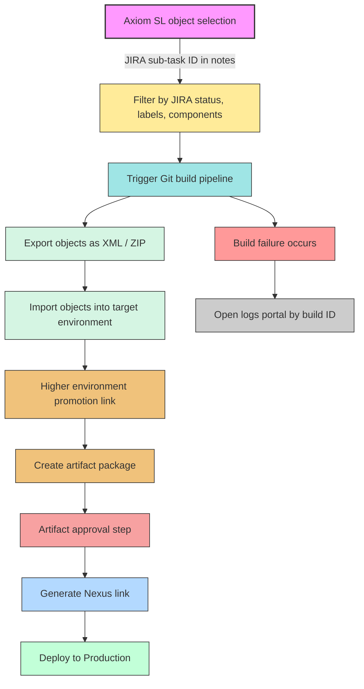

# Axiom SL CI/CD Flow Diagram

This diagram captures the current process for exporting and importing XML/ZIP objects across environments for Axiom SL.

## Current problem flow

1. Objects in Axiom SL are selected using metadata from JIRA:
   - JIRA sub-task number in notes
   - JIRA status
   - Specific labels and components
2. A Git build pipeline exports/imports the selected objects as XML or zipped files.
3. To move items to a higher environment, a separate link is used to create artifacts.
4. Created artifacts require approval before deployment.
5. Once approved, a Nexus link is issued.
6. The Nexus package is deployed into Production.
7. If a pipeline fails, logs are reviewed in a separate portal keyed by build ID.
