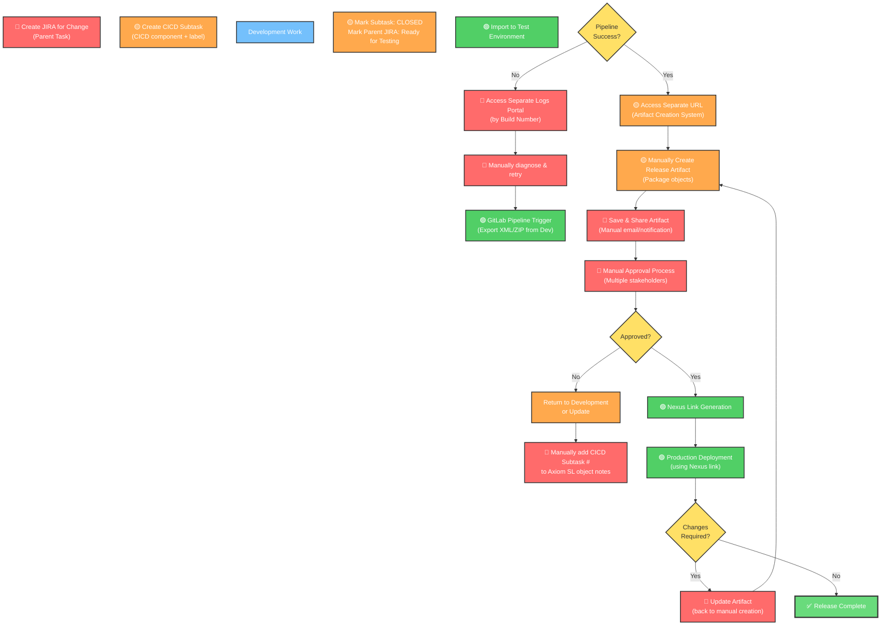

# Axiom SL Release Automation CI/CD Flow Diagram

This diagram captures the current end-to-end release automation process for Axiom SL and highlights the systemic challenges.

---

## Key Process Steps

1. **Change Initiation** → Create parent JIRA + CICD subtask (with CICD component/label)
2. **Development** → Work completed, subtask marked CLOSED, parent JIRA → "Ready for Testing"
3. **Object Linking** → CICD subtask # manually added to Axiom SL object notes
4. **Pipeline Export/Import** → GitLab pipeline exports XML/ZIP from Dev → imports to Test
5. **Failure Handling** → Pipeline failures → separate logs portal accessed by build #
6. **Higher Environment Promotion** → Separate artifact creation URL accessed
7. **Artifact Management** → Artifacts manually created, saved, and shared for approval
8. **Approval Gate** → Multiple stakeholders manually approve
9. **Nexus Release** → Approved artifacts → Nexus link generated
10. **Production Deployment** → Nexus link used for production release
11. **Change Handling** → Any change requires artifact update + re-approval + new Nexus link

---

## Key Problems & Challenges

### 🔴 **Critical Issues (Red)**
- **Manual JIRA-to-Axiom Linking**: CICD subtask # must be manually added to object notes (error-prone, untracked)
- **Disconnected Logging System**: Separate portal for pipeline logs breaks workflow context
- **Manual Approval Workflow**: No integrated approval system; manual email/notifications
- **Cascading Re-approvals**: Any change requires full re-approval cycle (no incremental updates)
- **No Audit Trail**: Changes and approvals not centrally tracked across systems

### 🟡 **Moderate Issues (Orange)**
- **Manual Artifact Creation**: Separate system for artifact packaging; no automation
- **State Synchronization**: JIRA status, Axiom objects, and artifacts not synchronized
- **Multiple Manual Handoffs**: Development → Testing → Artifact Creation → Approval → Nexus → Production
- **No Traceability**: Hard to track which code/objects are in which environment

### 🟢 **Automated Steps (Green)**
- GitLab pipeline execution (Dev/Test export-import)
- Nexus link generation and deployment

---

## Integration Gaps

| System | Purpose | Issue |
|--------|---------|-------|
| **JIRA** | Change tracking | No direct link to Axiom SL objects |
| **Axiom SL** | Configuration storage | Manual notes entry; no API integration |
| **GitLab** | Build/deployment pipeline | No approval gate integration |
| **Logs Portal** | Error diagnostics | Separate system; context switch required |
| **Artifact System** | Package creation | No automation; disconnected from JIRA/Axiom |
| **Approval Process** | Gate control | Manual; no audit log; no SLA tracking |
| **Nexus** | Release repository | Link-only integration; no feedback loop |

---

## Recommended Improvements

1. **Unified Integration Platform**: Single pane of glass for JIRA → Axiom SL → Pipeline → Approval → Nexus
2. **Automated Artifact Generation**: Trigger artifact creation directly from GitLab pipeline on merge
3. **Integrated Approval Workflow**: Built-in approval gates with SLA tracking and audit logs
4. **API-based Object Linking**: Axiom SL API to auto-tag objects with JIRA IDs (no manual entry)
5. **Centralized Logging**: Pipeline logs accessible from JIRA / Artifact portal
6. **Incremental Change Support**: Allow partial artifact updates without full re-approval
7. **Environment Parity**: Unified export/import across Dev/Test/Staging/Prod without separate URLs
8. **Change Impact Analysis**: Trace which objects are deployed to which environments
